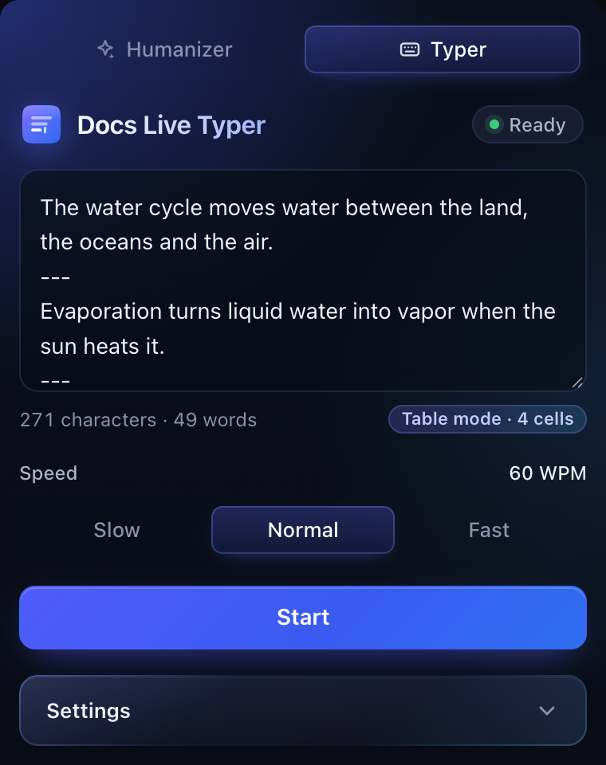
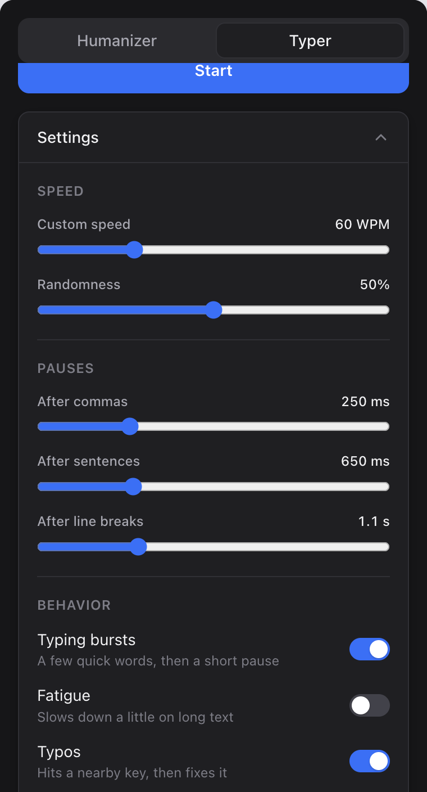

<div align="center">


# Docs Live Typer

**Watch text appear in Google Docs as if someone is typing it: live, one keystroke at a time.**

A Chrome side panel for testing the Google Docs editor and demoing what live typing looks like.


&nbsp;&nbsp;&nbsp;

</div>

---

## Features

- **Real keystrokes.** Text arrives in Docs one character at a time, through Chrome's own input pipeline. Line breaks become real paragraphs.
- **Natural rhythm.** Speeds vary, common letter pairs come faster, there are pauses after punctuation and short bursts of words, plus optional fatigue and typos that get fixed.
- **Fill whole tables.** Separate blocks with `---` and each one lands in the next table cell.
- **Runs in the background.** Close the panel or switch tabs and it keeps typing. Pause from anywhere with **Alt+Shift+P**.
- **Timing log.** Download a CSV of every run: speed, pauses, typos and keystroke latency per cell.
- **Humanize in one click.** Paste text in the Humanizer tab, press **Humanize**, and the result from [humanizeai.pro](https://www.humanizeai.pro/) lands in the Typer, ready to type.
- **Clean and simple.** Light and dark mode, keyboard friendly, no frameworks, no tracking, no build step.

## Quick start

**1. Install** (about a minute)

```bash
git clone https://github.com/satvikdaram/docs-live-typer.git
```

1. Open `chrome://extensions` and turn on **Developer mode** (top right).
2. Click **Load unpacked** and choose the `docs-live-typer` folder.
3. Pin **Docs Live Typer** from the puzzle-piece menu.

**2. Type your first doc**

1. Open a blank doc at [docs.new](https://docs.new).
2. Click the extension icon. The side panel opens.
3. In the **Typer** tab, paste some text and press **Start**.
4. Click into the doc during the 3-second countdown, and watch it type.

> Chrome shows a bar saying the extension *"started debugging this browser"*. That's expected: it's how real keystrokes reach Docs. Leave it open.

## Fill a table

Put a line with only `---` between blocks:

```
Planet
---
Fun fact
---
Mars
---
Home to the tallest volcano in the solar system.
```

Insert a table in your doc, click into the **first cell**, and press **Start**. The Typer shows **Table mode · 4 cells**, then fills them in order. Leave a block empty to skip a cell.

## Controls at a glance

| Want to… | Do this |
|---|---|
| Change speed | **Slow** / **Normal** / **Fast**, or **Settings → Custom speed** |
| Pause or resume | Main button, or **Alt+Shift+P** from any tab |
| Stop | **Stop** (what's typed stays) |
| Add typos, bursts or fatigue | **Settings → Behavior** |
| Change pause lengths | **Settings → Pauses** |
| Get the timing data | **Download timing log** after a run |
| Humanize text first | Paste it in the **Humanizer** tab and press **Humanize** |
| Build table cells one by one | **Add as cell** in the Humanizer tab |

## Documentation

| | |
|---|---|
| [User guide](docs/guide.md) | Every feature, step by step |
| [Troubleshooting](docs/troubleshooting.md) | Fixes for the common hiccups |
| [Customizing](docs/customizing.md) | Change the typing rhythm and defaults |
| [How it works](docs/how-it-works.md) | Architecture, permissions, design notes |

## FAQ

**Why does Chrome say it's being debugged?**
Google Docs ignores fake JavaScript key events, so the extension sends real ones through Chrome's debugger API. Chrome always shows that bar when an extension does this. [More](docs/troubleshooting.md#the-started-debugging-this-browser-bar)

**Does it send my text anywhere?**
No. The Typer only talks to your own Chrome. Nothing is collected or uploaded. **Humanize** sends your text to humanizeai.pro, the same as using that site yourself, under its own terms.

**Will it work on Google Slides, Sheets or other sites?**
No. It only types into Google Docs documents in edit mode.

**Can I change how it types?**
Yes. Most things are in **Settings**, and every timing number is in [`timing.js`](timing.js). See [Customizing](docs/customizing.md).

## Contributing

Issues and pull requests are welcome. It's plain HTML, CSS and JavaScript: edit a file, click reload on `chrome://extensions`, and test on a blank doc. See [How it works](docs/how-it-works.md) for a tour of the code.

## License

[MIT](LICENSE). Not affiliated with Google or humanizeai.pro.
